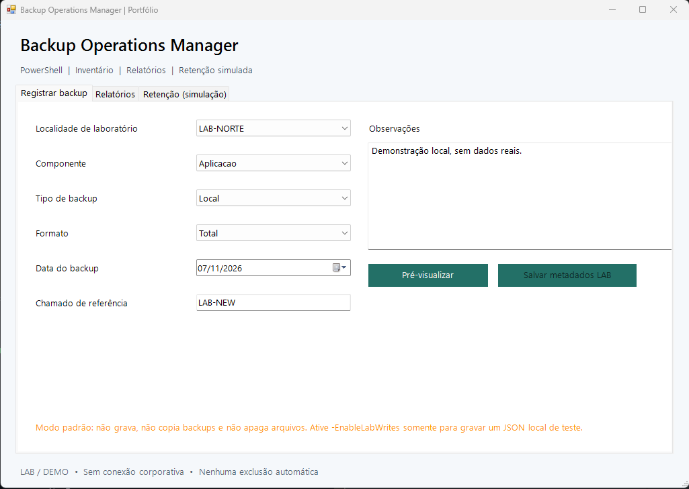

# Backup Operations Manager

**Gerenciador demonstrativo de registros de backup, histórico e planejamento de retenção com PowerShell e Windows Forms.**

   

> **Projeto para portfólio:** implementação genérica, com recursos fictícios, independente de infraestrutura corporativa. Gerencia **metadados** de backups, não realiza backup ou restauração de bancos de dados e não apaga arquivos. Não foi homologado para produção.

## Demonstração da interface



*Captura da demonstração em Windows Forms. O link da imagem funcionará após o arquivo `images/backup_preview.png` ser incluído no commit e enviado ao GitHub.*

## Funcionalidades

| Área | Demonstração técnica |
| --- | --- |
| Registro | Pré-visualização e cadastro de metadados com identificadores únicos |
| Histórico e relatórios | Consulta por filtros e exportação para CSV ou HTML (impressão em PDF pelo navegador) |
| Retenção | Identificação de registros antigos, **sem exclusão automática de arquivos** |
| Persistência local | Escrita opcional de registros em JSON dentro de `lab-data/` (ignorada pelo Git) |
| SQL Server | Exemplo isolado de persistência ADO.NET parametrizada em instância local de laboratório |
| Qualidade | Testes Pester, validação de sintaxe, verificações básicas de segurança e GitHub Actions |

## Executar a demonstração

Requisitos: **Windows PowerShell 5.1+**, Windows Forms e Windows 10/11 ou Windows Server com interface gráfica.

Abra a pasta do repositório no Windows e execute **`Start-Demo.cmd`** ou use:

```powershell
powershell.exe -NoProfile -ExecutionPolicy Bypass -STA -File ".\gui\Start-BackupGui.ps1"
```

A interface inicia com registros fictícios e tem abas de cadastro, relatórios e retenção simulada. Por padrão, não escreve nem remove arquivos.

Para testar pelo terminal:

```powershell
.\BackupOperations.ps1
.\BackupOperations.ps1 -Action Retention
.\BackupOperations.ps1 -Action Register -Site LAB-NORTE -Component Banco -Type Local -Format Total
```

Para testar a inicialização gráfica sem abrir uma janela:

```powershell
.\gui\Start-BackupGui.ps1 -ValidateOnly
```

### Persistência opcional no laboratório

Somente se desejar testar a gravação **de metadados** em JSON local:

```powershell
.\BackupOperations.ps1 -Action Register -Site LAB-NORTE -Component Aplicacao `
  -Type Remoto -Format Parcial -Ticket LAB-202 -Apply -ConfirmEnvironment LAB
```

Na GUI, a gravação precisa ser habilitada explicitamente com `-EnableLabWrites`. Os dados locais são excluídos do versionamento pelo `.gitignore`.

## Integração SQL Server (opcional)

O repositório inclui `sql/schema.sql` e `scripts/Save-BackupEntrySql.ps1` para demonstrar comandos parametrizados em um SQL Server **local e descartável**, com autenticação integrada. Essa etapa não é executada automaticamente e **não é necessária** para testar a GUI.

Leia [Segurança e limitações](docs/SAFETY.md) antes de configurar um laboratório.

## Testes

```powershell
Install-Module Pester -MinimumVersion 5.0 -Scope CurrentUser
Invoke-Pester .\tests
.\scripts\Smoke-Test.ps1
.\scripts\Verify-PublicContent.ps1
```

O GitHub Actions realiza testes automatizados, análise de sintaxe e verificações básicas de segurança. A CI não comprova integração real com SQL Server ou homologação para produção.

## Estrutura do projeto

```text
powershell-backup-operations-manager/
├── BackupOperations.ps1           # CLI
├── Start-Demo.cmd                 # Inicia a GUI no Windows
├── gui/Start-BackupGui.ps1        # Interface Windows Forms
├── src/BackupOperations.psm1      # Regras de negócio
├── src/SqlLabRepository.psm1      # Repositório SQL opcional
├── examples/                      # Configurações e registros fictícios
├── sql/schema.sql                 # Schema de laboratório
├── scripts/                       # Validação e exemplo SQL
├── tests/                         # Testes Pester
├── docs/                          # Arquitetura e segurança
├── images/backup_preview.png      # Captura da interface
└── .github/workflows/             # Pipeline CI
```

## Segurança e limitações

- Não inclui o script corporativo original, backups reais, senhas ou servidores internos.
- A retenção gera recomendações, mas **não exclui pastas ou arquivos**.
- A escrita exige opção explícita e confirmação de laboratório.
- A aplicação **não é** uma solução de backup, restauração ou recuperação de desastres.

Documentação: [Arquitetura](docs/ARCHITECTURE.md) · [Segurança](docs/SAFETY.md) · [Testes no Windows](docs/TESTING.md).

## Melhorias planejadas

- [x] Documentação visual da interface (a imagem será exibida após o push).
- [ ] Testes de integração com SQL Server em laboratório isolado.
- [ ] Logs estruturados e métricas por operação.
- [ ] Tratamento de concorrência e recuperação de falhas na persistência.

---

**Autor:** [Phelppis](https://github.com/Phelppis) — projeto demonstrativo de automação e sustentação de aplicações.
