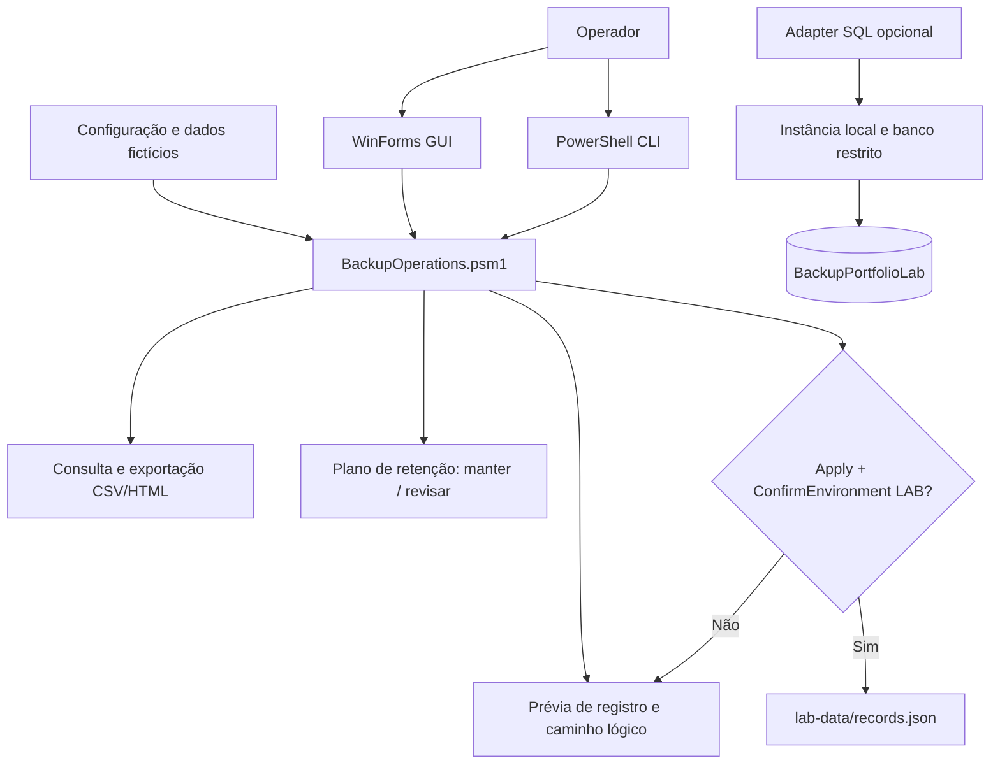

# Arquitetura

A GUI chama o mesmo módulo que a CLI. As opções de exportação são ações explícitas do operador. A retenção nunca acessa ou exclui pastas: avalia apenas metadados em memória.

**Identidade dos dados:** o ID é um GUID do registro administrativo; não é hash do arquivo de backup e não comprova que o backup foi gerado, copiado ou validado.

**Hierarquia lógica:** `lab-storage/<Total|Parcial|Rede>/<site>/<componente>/<data>_<id>_<formato>`. Essa hierarquia é exibida como sugestão; o projeto não cria a pasta automaticamente.

**Conexão SQL:** a UI não depende de SQL Server. O módulo SQL fica separado para demonstrar adoção incremental de persistência relacional com consultas parametrizadas.
